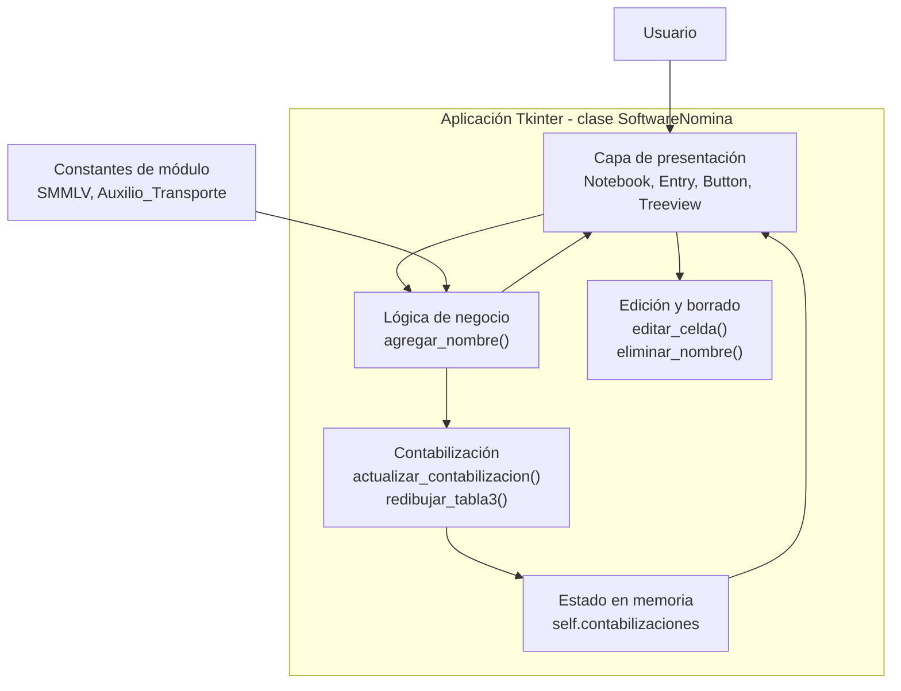
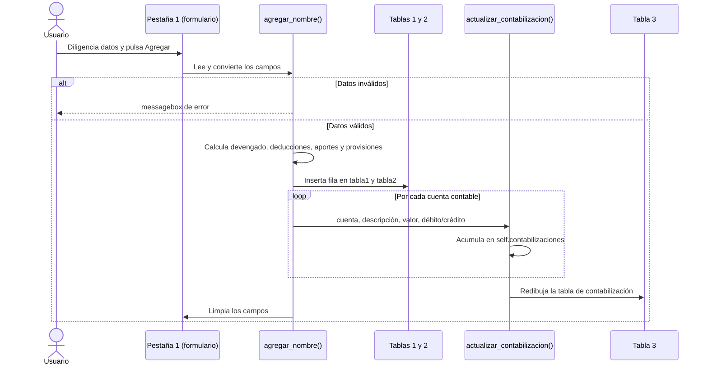

# Sistema de Nómina


<!-- TODO: agregar badge de licencia cuando se defina -->

Aplicación de escritorio desarrollada en Python y Tkinter que automatiza la liquidación mensual de nómina para empleados en Colombia: calcula el devengado, las deducciones del trabajador, los aportes y provisiones a cargo del empleador y genera la contabilización por cuenta.

---

## Tabla de contenidos

1. [Descripción y propósito](#descripción-y-propósito)
2. [Características principales](#características-principales)
3. [Capturas de pantalla](#capturas-de-pantalla)
4. [Arquitectura](#arquitectura)
5. [Reglas de cálculo](#reglas-de-cálculo)
6. [Stack tecnológico](#stack-tecnológico)
7. [Estructura del proyecto](#estructura-del-proyecto)
8. [Requisitos previos](#requisitos-previos)
9. [Instalación y ejecución](#instalación-y-ejecución)
10. [Uso](#uso)
11. [Configuración](#configuración)
12. [Limitaciones conocidas](#limitaciones-conocidas)
13. [Roadmap](#roadmap)
14. [Guía de contribución](#guía-de-contribución)
15. [Licencia](#licencia)
16. [Autor](#autor)

---

## Descripción y propósito

Liquidar una nómina manualmente implica aplicar varias reglas (auxilio de transporte, recargos por horas extras, aportes a seguridad social, parafiscales y prestaciones sociales) de forma repetitiva y propensa a errores. Este proyecto centraliza esas reglas en una interfaz gráfica sencilla: el usuario ingresa los datos básicos del empleado y la aplicación calcula y presenta, en tres vistas, el detalle de la nómina, los aportes y prestaciones del empleador, y el asiento contable resultante.

**Público objetivo:** estudiantes de contabilidad y desarrollo de software, y pequeñas empresas que requieran una herramienta de apoyo para entender o simular la liquidación de nómina.
<!-- TODO: confirmar público objetivo y, si aplica, agregar contexto académico (materia, institución, objetivos de aprendizaje). -->

> **Nota:** el proyecto es un prototipo con fines educativos. Antes de usarlo en un entorno real, valide los resultados con un contador o con la normativa laboral vigente (ver [Limitaciones conocidas](#limitaciones-conocidas)).

## Características principales

- Registro de empleados con validación de datos de entrada.
- Cálculo de sueldo proporcional a los días laborados.
- Cálculo de horas extras diurnas (recargo 25 %) y nocturnas (recargo 75 %).
- Auxilio de transporte automático para salarios de hasta 2 SMMLV.
- Deducciones del trabajador (salud y pensión) y cálculo del neto a pagar.
- Aportes del empleador: salud, pensión, ARL (niveles de riesgo 1 a 5), caja de compensación, SENA e ICBF.
- Provisiones de prestaciones sociales: cesantías, intereses sobre cesantías, prima de servicios y vacaciones.
- Contabilización automática por cuenta, acumulada entre empleados.
- Edición de celdas con doble clic y eliminación de registros seleccionados.
- Interfaz con tema oscuro y pestañas.

## Capturas de pantalla

<!-- TODO: agregar las capturas en docs/img/ y ajustar los nombres de archivo. -->

| Nómina Básica | Aportes y Prestaciones | Contabilizaciones |
|:---:|:---:|:---:|
|  |  |  |

---

## Arquitectura

### Visión general

La aplicación es un **monolito de escritorio de un solo archivo**, organizado alrededor de una clase principal (`SoftwareNomina`) que concentra la interfaz, la lógica de negocio y el estado. No utiliza base de datos ni servicios externos: todo el estado vive en memoria mientras la ventana está abierta.

Principios de diseño observables en el código:

- **Cero dependencias externas:** solo biblioteca estándar de Python (`tkinter`).
- **Cálculo en el momento del registro:** todos los valores derivados se calculan una única vez dentro de `agregar_nombre()` y se distribuyen a las tres vistas.
- **Parámetros legales como constantes:** `SMMLV` y `Auxilio_Transporte` están definidos a nivel de módulo para facilitar su actualización anual.
- **Contabilización acumulativa:** las cuentas se agregan por clave `(cuenta, descripción)`, de modo que varios empleados se consolidan en un único renglón por cuenta.

### Diagrama de componentes



### Flujo principal: registrar un empleado



### Capas y responsabilidades

| Capa | Elementos | Responsabilidad |
|---|---|---|
| Configuración | `SMMLV`, `Auxilio_Transporte` | Parámetros legales fijos del cálculo. |
| Presentación | `crear_pestana1/2/3`, `ttk.Notebook`, `ttk.Treeview` | Formulario de captura y tres vistas de resultados. |
| Lógica de negocio | `agregar_nombre()` | Validación, cálculo de nómina, aportes y provisiones. |
| Contabilidad | `actualizar_contabilizacion()`, `redibujar_tabla3()` | Consolidación de débitos y créditos por cuenta. |
| Interacción | `editar_celda()`, `eliminar_nombre()`, `limpiar_campos()` | Edición en línea, borrado y reinicio del formulario. |

### Modelo de datos

No existe base de datos. Los datos se almacenan en dos lugares:

- **Widgets `Treeview`** (`tabla1`, `tabla2`, `tabla3`): contienen los valores ya formateados como texto (por ejemplo `"$1,423,500"`).
- **Diccionario `self.contabilizaciones`:** única estructura de datos de negocio.

```python
self.contabilizaciones = {
    ("510506", "Sueldo"): {"debito": 1423500, "credito": 0},
    # (cuenta, descripción): {"debito": valor_acumulado, "credito": valor_acumulado}
}
```

**Campos de entrada (Pestaña 1)**

| Campo | Tipo esperado | Validación |
|---|---|---|
| Nombre del empleado | Texto | No vacío |
| Documento | Numérico | Solo dígitos |
| Sueldo básico | Entero | Convertible a `int` |
| Días laborados | Entero | Convertible a `int` |
| Horas extras diurnas | Entero | Convertible a `int` |
| Horas extras nocturnas | Entero | Convertible a `int` |
| Nivel de ARL | Entero | Valor entre 1 y 5 |

### Decisiones técnicas clave

| Decisión | Justificación |
|---|---|
| Tkinter como framework de interfaz | Incluido en la biblioteca estándar, sin instalación adicional; adecuado para un prototipo de escritorio. |
| Estado en memoria, sin persistencia | Simplifica el prototipo y evita dependencias; a cambio, los datos se pierden al cerrar. |
| Constantes de módulo para SMMLV y auxilio | Permite actualizar los valores legales en un solo lugar cada año. |
| Contabilización agregada por `(cuenta, descripción)` | Genera un asiento consolidado legible sin recorrer todas las filas. |
| Cálculo centralizado en `agregar_nombre()` | Un único punto de verdad para las fórmulas; ver [Roadmap](#roadmap) para su futura separación. |

### Seguridad, escalabilidad y rendimiento

- **Seguridad:** la aplicación es local, no expone red, no maneja credenciales ni persiste información personal. Los datos de empleados (nombre y documento) solo existen en memoria durante la sesión.
- **Escalabilidad:** pensada para un volumen reducido de empleados por sesión. No hay paginación ni almacenamiento, por lo que no está diseñada para nóminas grandes.
- **Rendimiento:** los cálculos son aritmética simple; el costo dominante es el redibujado de la tabla de contabilización, que se reconstruye completa en cada alta.

---

## Reglas de cálculo

Todas las fórmulas provienen de `agregar_nombre()`.

**Devengado**

| Concepto | Fórmula |
|---|---|
| Sueldo | `(salario / 30) * días_laborados` |
| Valor hora | `salario / 230` |
| Horas extras diurnas | `valor_hora * 1.25 * horas` |
| Horas extras nocturnas | `valor_hora * 1.75 * horas` |
| Auxilio de transporte | `Auxilio_Transporte` si `salario <= 2 * SMMLV`, de lo contrario `0` |
| **Devengado** | `sueldo + auxilio + extras diurnas + extras nocturnas` |

**Deducciones del trabajador**

| Concepto | Fórmula |
|---|---|
| Salud (4 %) | `(sueldo + extras) * 0.04` |
| Pensión (4 %) | `(sueldo + extras) * 0.04` |
| **Neto a pagar** | `devengado - salud - pensión` |

**Aportes y provisiones del empleador** (base: `devengado`, salvo indicación)

| Concepto | Porcentaje |
|---|---|
| Salud | 8.5 % |
| Pensión | 12 % |
| ARL | Nivel 1: 0.522 %, Nivel 2: 1.044 %, Nivel 3: 2.436 %, Nivel 4: 4.350 %, Nivel 5: 6.960 % |
| Caja de compensación | 4 % |
| SENA | 2 % |
| ICBF | 3 % |
| Cesantías | 8.33 % |
| Intereses sobre cesantías | 12 % de las cesantías calculadas |
| Prima de servicios | 8.33 % |
| Vacaciones | 4.17 % (base: `sueldo`) |

**Cuentas contables generadas**

| Cuenta | Descripción | Naturaleza |
|---|---|---|
| 510506 | Sueldo | Débito |
| 510527 | Auxilio Transporte | Débito |
| 510515 | Horas Extra | Débito |
| 237005 | Aportes a EPS | Crédito |
| 238030 | Aportes a pensión | Crédito |
| 237010 | Aportes Salud Empleador | Crédito |
| 238035 | Aportes Pensión Empleador | Crédito |
| 237015 | ARL | Crédito |
| 237020 | Caja de Compensación | Crédito |
| 237025 | SENA | Crédito |
| 237030 | ICBF | Crédito |
| 251005 | Cesantías | Crédito |
| 251010 | Intereses Cesantías | Crédito |
| 251015 | Prima de Servicios | Crédito |
| 251020 | Vacaciones | Crédito |

---

## Stack tecnológico

| Tecnología | Versión | Rol |
|---|---|---|
| Python | 3.x <!-- TODO: indicar versión mínima probada --> | Lenguaje de programación |
| Tkinter / ttk | Incluido con Python | Interfaz gráfica |
| `tkinter.messagebox` | Incluido con Python | Mensajes de error al usuario |

## Estructura del proyecto

<!-- TODO: ajustar nombres de archivos y carpetas reales. -->

```
.
├── nomina.py        # Aplicación completa (interfaz, lógica y contabilización)
├── docs/
│   └── img/         # Capturas de pantalla usadas en este README
└── README.md
```

## Requisitos previos

- Python 3 instalado y disponible en el `PATH`.
- Tkinter disponible. En Windows y macOS viene con el instalador oficial de Python. En Linux (Debian/Ubuntu) puede requerir:

```bash
sudo apt install python3-tk
```

Verificación:

```bash
python --version
python -m tkinter
```

El segundo comando abre una ventana de prueba si Tkinter está correctamente instalado.

## Instalación y ejecución

No hay dependencias que instalar.

```bash
# 1. Clonar el repositorio
git clone https://github.com/Campriet03/<nombre-del-repositorio>.git   # TODO: reemplazar por la URL real
cd <nombre-del-repositorio>

# 2. Ejecutar la aplicación
python nomina.py   # TODO: confirmar el nombre real del archivo
```

## Uso

1. **Pestaña "Nómina Básica":** diligencie los siete campos del formulario y pulse **Agregar**. La fila del empleado aparece en la tabla inferior con sueldo, auxilio, extras, devengado, deducciones y neto.
2. **Pestaña "Aportes y Prestaciones":** muestra, en el mismo orden de registro, los aportes del empleador y las provisiones de prestaciones sociales.
3. **Pestaña "Contabilizaciones":** presenta el asiento consolidado por cuenta, con columnas de débito y crédito.
4. **Editar:** haga doble clic en una celda de la tabla de nómina, escriba el nuevo valor y presione `Enter` (solo admite valores numéricos).
5. **Eliminar:** seleccione una fila en cualquiera de las tablas y pulse **Eliminar**.

**Ejemplo de captura**

| Campo | Valor |
|---|---|
| Nombre del empleado | Juan Pérez |
| Documento | 1012345678 |
| Sueldo básico | 1423500 |
| Días laborados | 30 |
| Horas extras diurnas | 0 |
| Horas extras nocturnas | 0 |
| Nivel de ARL | 1 |

## Configuración

Los parámetros legales se modifican directamente en las constantes al inicio del archivo:

```python
SMMLV = 1423500
Auxilio_Transporte = 200000
```

> Estos valores corresponden a un año específico y deben actualizarse cada vez que el Gobierno fije el nuevo salario mínimo y auxilio de transporte.
<!-- TODO: indicar el año de vigencia de estos valores. -->

## Limitaciones conocidas

Estas son limitaciones del estado actual del código, documentadas para transparencia técnica:

**Funcionales**

- **Sin persistencia:** al cerrar la ventana se pierde toda la información.
- **Edición solo visual:** editar una celda con doble clic modifica el texto mostrado, pero no recalcula los demás valores ni la contabilización. Además, solo acepta números, por lo que no permite editar el nombre.
- **Eliminación parcial:** borrar una fila de una tabla no elimina la fila correspondiente en las otras ni revierte los valores de la contabilización.
- **Sin identificación de empleado en la pestaña 2:** las filas se relacionan con la pestaña 1 únicamente por el orden de inserción.
- **Validaciones básicas:** no se verifica que los días estén entre 0 y 30, ni que los valores numéricos sean no negativos.

**Contables**

- **Asiento no balanceado:** el programa genera débitos por devengado y créditos por deducciones, aportes y provisiones, pero no registra el gasto de los aportes y prestaciones del empleador (contrapartida de esos créditos) ni la cuenta por pagar del neto al empleado.

**Normativas** (validar con un contador antes de uso real)

- El **auxilio de transporte** se incluye en la base de los aportes del empleador (salud, pensión, ARL, caja, SENA, ICBF), cuando normalmente no hace parte de la base de seguridad social ni de parafiscales.
- Salud del empleador, SENA e ICBF se calculan siempre, sin considerar la posible **exoneración** aplicable a ciertos empleadores y salarios.
- El divisor de **230 horas mensuales** para el valor hora es fijo; la jornada laboral legal ha cambiado en los últimos años.
- Los valores de **SMMLV y auxilio** son constantes manuales (ver [Configuración](#configuración)).

## Roadmap

<!-- TODO: confirmar cuáles de estas mejoras desea priorizar. -->

- [ ] Separar la lógica de cálculo de la interfaz (módulo independiente y testeable).
- [ ] Pruebas unitarias de las fórmulas de nómina.
- [ ] Persistencia de datos (SQLite o archivos JSON/CSV).
- [ ] Exportación de reportes a Excel o PDF.
- [ ] Recalcular nómina y contabilización al editar o eliminar un registro.
- [ ] Asiento contable balanceado (gasto del empleador y cuenta por pagar).
- [ ] Parámetros legales configurables desde archivo, sin editar el código.
- [ ] Validaciones de rango en todos los campos.

## Guía de contribución

<!-- TODO: ajustar al flujo real del proyecto. -->

1. Haga un *fork* del repositorio y cree una rama descriptiva:
   ```bash
   git checkout -b feat/nombre-de-la-mejora
   ```
2. Use mensajes de commit con el formato [Conventional Commits](https://www.conventionalcommits.org/es/) (`feat:`, `fix:`, `docs:`, `refactor:`).
3. Verifique que la aplicación se ejecuta sin errores antes de enviar los cambios.
4. Abra un *Pull Request* describiendo qué cambia y por qué.

## Licencia

<!-- TODO: definir licencia (por ejemplo MIT) y agregar el archivo LICENSE. -->
Pendiente de definir.

## Autor

**Camilo Alejandro Prieto Villarreal**
GitHub: [@Campriet03](https://github.com/Campriet03)
